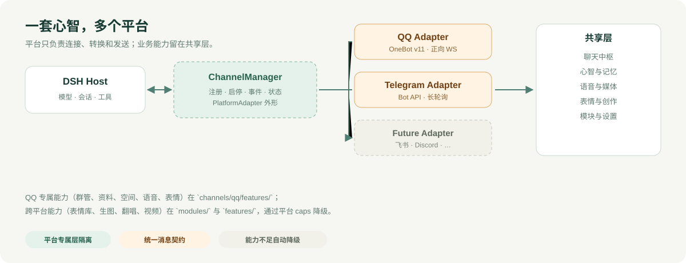
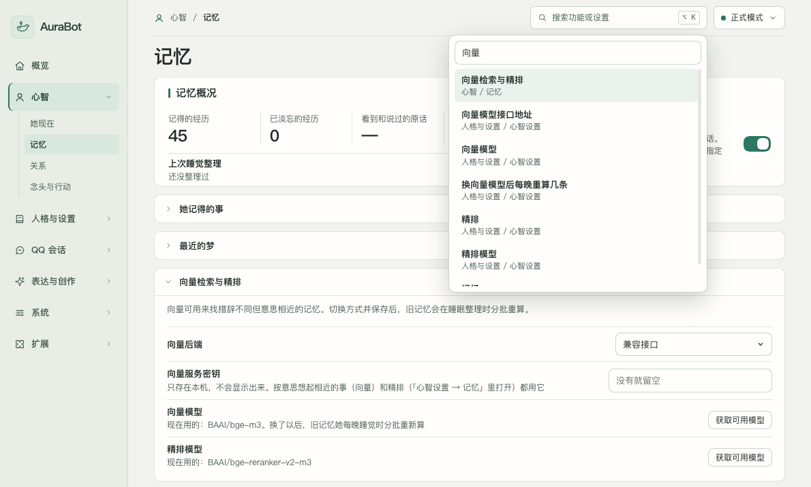

<div align="center">


# AuraBot for macOS

**把大肥鱼接入 QQ 和 Telegram，让她在不同会话里延续同一份记忆、心情和关系。**

DeepSeek Harness 插件 · Apple 芯片 Mac · 多平台适配器 · OneBot v11

[](https://github.com/Geng-zy/aurabot-qq-mac/releases/latest)
[](#开发与测试)
[](package.json)
[](LICENSE)
[](#平台)

[下载最新版](https://github.com/Geng-zy/aurabot-qq-mac/releases/latest) · [快速安装](#快速安装) · [核心能力](#核心能力) · [使用手册](docs/USER-MANUAL.md) · [English](README_EN.md)

</div>



> 上图是平台架构示意；界面截图见 [docs/screenshots](docs/screenshots)。

## 这是什么

AuraBot 是 [DeepSeek Harness](https://github.com/deepseek-ai/deepseek-harness) 的 macOS 插件。它把聊天平台、人格与记忆、模型调用、语音与创作能力接在一个工作台里，并且让所有平台共用同一套心智。

这一版的重点不是再堆一个功能，而是把“她”做成一套可持续运行的系统：

```text
DSH 宿主
   ↓
AuraBot Host
   ↓
ChannelManager
   ├── QQ Adapter        OneBot v11 / 正向 WebSocket
   ├── Telegram Adapter  长轮询 Bot API
   └── 后续平台 Adapter
   ↓
共享层：聊天中枢 / 心智 / 记忆 / 知识库 / 表情 / 语音 / 生图 / 模块
```

平台只负责连接、消息转换和发送；QQ 专属能力收在 `src/channels/qq/features/`，不会污染通用模块。

## 1.5.11 更新

### 同一只鱼

- 记忆、情绪、人格和关系继续跨会话共享。
- 出站隐私、分享、提醒和面板仍按会话边界过滤，不会把另一个私聊的内容直接带出去。
- 修复了跨分片 UTF-8 解码、Host 白名单、POSIX 会话目录、头像上传上限、QQ WebSocket 超时等运行问题。

### 群聊秘书闸

- 可选：先用便宜模型判断一段群聊值不值得叫主模型。
- 所有平台群聊通用；`@`、引用、叫名字的必回消息不经过闸。
- 支持全局配置、按群覆盖、按群开关、最近判断日志、持久化统计和按天汇总。
- 面板路径：`QQ 会话 → 回复规则 → 群聊秘书闸 / 最近秘书判断`。

### 知识库

- `data/knowledge/raw` 与 `data/knowledge/notes`，支持 Markdown / txt。
- 按 `all / private / group / 具体会话` 控制可见范围。
- 面板支持浏览、全文搜索、高亮、分页、预览、写笔记、导入单文件、导入文件夹并保留目录、改名和删除。
- 模型工具：`knowledge_search`、`knowledge_read`、`knowledge_note_create`。

### 表情库

- 保留 QQ 小黄脸、QQ 收藏表情和 QQ 商城 `mface`。
- 通用表情库支持 MD5 精确去重和 dHash 近似去重。
- 可选统一转 WebP；同一名字支持多变体和主图。
- 跨平台发送时按平台能力降级，QQ 商城表情不会硬塞给其他平台。

### 生图

支持以下 provider：

```text
openai
seedream（豆包）
xai
gemini
sensenova
comfyui
custom
codex
local
```

- ComfyUI 直连支持 API workflow、提示词节点、LoadImage 参考图、输出节点和轮询。
- 面板可做真实连通性测试，失败原因持久化，成功后自动清除。
- 自定义接口支持 URL 占位符、参考图和响应路径。

### 平台与稳定性

- QQ：私聊、群聊、引用、合并转发、语音收发、文件、贴表情、群管、好友/加群申请、改资料、QQ 空间。
- Telegram：长轮询、文字、回复、图片上传。
- 其他平台通过 `PlatformAdapter` / `ChannelManager` 继续接入。
- 统一使用 `caps`：没有原生能力时降级或跳过，不破坏平台边界。

## 平台

| 平台 | 当前能力 | 配置位置 |
| --- | --- | --- |
| **QQ** | 私聊、群聊、引用、合并转发、语音收发、文件、贴表情、群管、好友/加群申请、改资料、QQ 空间 | `QQ 会话` |
| **Telegram** | 长轮询、文字、回复、图片（base64 图片走 multipart 上传） | `平台 → Telegram` |
| **其他平台** | 通过 `PlatformAdapter` / `ChannelManager` 继续接入 | 后续按平台扩展 |

## 核心能力

| 功能 | 你可以怎么用 |
| --- | --- |
| **私聊与群聊** | 按白名单开放会话，设置群聊回应、主动插话和连发合并；支持引用、合并转发和语音识别。 |
| **记忆、情绪与关系** | 把聊天整理成经历，按日期、关键词或语义回想；查看记忆来源、关系变化和私聊可见范围。 |
| **群聊秘书闸** | 用轻量模型先在群里判断是否接话，减少无意义的主模型调用。 |
| **知识库** | 把设定、资料和笔记放进可检索的资料库，并按会话控制可见性。 |
| **念头与行动** | 查看内心日记、愿望和行动状态；结合近况、精力与动机决定是否主动联系你。 |
| **语音与创作** | 发语音、使用表情包、翻唱、画图、生视频；按需接入本地或在线服务。 |
| **QQ 空间** | 写说说、预览配图、按可见范围发布，归档公开浏览图并处理空间互动。 |
| **扩展与维护** | 在 DSH 内管理模块、日志、用量和备份；模块库只安装本分支兼容模块。 |

## 快速安装

**需要：** Apple 芯片 Mac、[DeepSeek Harness](https://github.com/deepseek-ai/deepseek-harness) 桌面版、DSH `0.2.2-rc.3` 或更新版本。QQ 还需要一套 OneBot v11 网关（如 [SnowLuma](https://github.com/SnowLuma/SnowLuma.Docker.Framework)）和单独的机器人 QQ 号。

1. 打开 DSH 完成初始化，并配置聊天模型。
2. 从 [Releases](https://github.com/Geng-zy/aurabot-qq-mac/releases/latest) 下载 `dsh-aurabot-qq-1.5.13.tgz`。
3. 完全退出 DSH，在终端安装：

   ```bash
   dsh="/Applications/DeepSeek Harness.app/Contents/Resources/runtime/cli/bin/dsh"
   "$dsh" plugin --profile desktop -- add "file:$HOME/Downloads/dsh-aurabot-qq-1.5.13.tgz" --offline
   ```

4. 重开 DSH，从左栏进入 **Aurabot**。
5. QQ：在 `QQ 会话 → 连接` 填 OneBot WebSocket 地址和令牌，再填机器人号与管理员号。
6. Telegram：在 `平台 → Telegram` 填 Bot Token、管理员 ID 和白名单。
7. 先用「试运行」验证回复，确认连接和白名单后再切「正式模式」。

更新时下载新版本的 `.tgz`，用同一命令安装并重启 DSH。插件代码与个人数据分开保存。

[完整设置与排障](docs/USER-MANUAL.md) · [版本更新记录](CHANGELOG.md)

## 界面导览

右上角用 **⌥ K** 搜索功能和设置。再次点击当前分组可收起子页；内心日记、愿望、记忆和知识库等长列表默认收起。界面动效遵循系统的「减少动态效果」设置。

| 想做什么 | 从哪里进入 |
| --- | --- |
| 查刚刚发生的事或调整隐私 | 心智 → 记忆 |
| 看人物关系或内心日记 | 心智 → 关系 / 念头与行动 |
| 看资料、写笔记或控制知识可见范围 | 心智 → 知识库 |
| 修改人设、性格设置和后台预算 | 自我与设置 |
| 配置 QQ 连接、白名单或空间日记 | QQ 会话 |
| 配置 Telegram | 平台 → Telegram |
| 配置语音、生图、表情或翻唱 | 表达与创作 |
| 看日志、备份或接入自定义脚本 | 系统 |

<details>
<summary>查看关系页和功能搜索截图</summary>

<p><strong>人物关系</strong> · 在人物卡查看称呼、印象、亲近与信任，或切换到星图。</p>


<p><strong>设置搜索</strong> · 输入「向量」，可直接到记忆页并展开「向量检索与精排」。</p>


</details>

## 按需配置本地模型

- **记忆检索**：在线默认使用硅基流动 `BAAI/bge-m3`，可开启 `BAAI/bge-reranker-v2-m3` 精排；也可切换到随包离线中文向量模型或关键词检索。
- **本地小模型**：在「自我与设置 → 设置 → 本地模型」按需安装 Qwen3.5-9B 和 MLX 运行环境。
- **本地生图**：Apple 芯片 + macOS 26 或更新版本可一键部署 MFLUX 与 Qwen Image 2.1；也支持自定义脚本和兼容的在线接口。
- **语音与翻唱**：在「表达与创作」里按需安装或接入本地/在线服务。

## 项目结构

```text
src/
  channels/
    adapter-facade.js      统一 PlatformAdapter 外形
    registry.js            平台注册表
    manager.js             ChannelManager
    qq/                    QQ 适配器
      transport.js         OneBot 连接
      convert.js           消息转换
      features/            QQ 群管、资料、空间、语音、表情等
    telegram/              Telegram 适配器
  chat/                    聊天中枢、规则、输出、秘书闸
  mind/                    心智核心
  mind-adapter/            DSH 对接层
  modules/                 跨平台业务模块
  features/                通用能力
    knowledge.js           知识库
    sticker-hash.js        dHash / WebP
    imagegen.js            生图 provider
  core/                    配置、模块、存储、安全
client/                    面板 UI
test/                      离线测试与回归
docs/                      设计、手册、迁移与审计
```

## 开发与测试

需要 Node.js ≥ 24.0.0。

```bash
npm test
npm run check
```

当前回归：

```text
393 个文件语法检查通过
1559 个测试通过
```

也提供离线心智回放：

```bash
npm run mind:replay
npm run mind:privacy
```

## 数据与安全

| 位置 | 内容 |
| --- | --- |
| `~/.dsh/plugins-data/aurabot/` | 设置、人格、记忆、知识库、日志与模块数据 |
| `~/Aurabot/` | 默认 QQ 工作区和本地念头、语音、翻唱环境 |

- 平台 token、API key、WebDAV 密码等不会回传到面板。
- 工具按平台 `caps` 降级，不支持的平台不会收到平台专属格式。
- 群聊本机工具默认关闭，只允许管理员发言的轮次使用。
- 安装模块前请核对来源；模块和插件在同一进程运行，能力声明不是沙箱。

## 来源与许可

本仓库由 [Geng-zy](https://github.com/Geng-zy) 维护，fork 自 [aureth-labs/dsh-aurabot-qq](https://github.com/aureth-labs/dsh-aurabot-qq) v1.2.0。QQ 聊天、语音、表情、翻唱、QQ 空间和模块系统承自上游及其贡献者。

许可证：[MIT](LICENSE) · 第三方素材与署名：[THIRD-PARTY-NOTICES.md](THIRD-PARTY-NOTICES.md)

[使用手册](docs/USER-MANUAL.md) · [功能、设计与实现](docs/FEATURES-AND-IMPLEMENTATION.md) · [维护交接](docs/HANDOFF.md) · [模块开发教程](docs/MODULE-TUTORIAL.md) · [模块 API](src/modules/API.md) · [macOS 模块库](https://github.com/Geng-zy/aurabot-qq-mac-mods)
