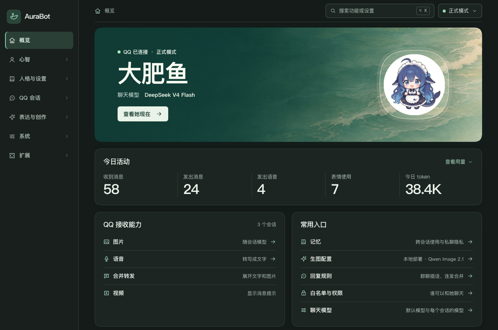
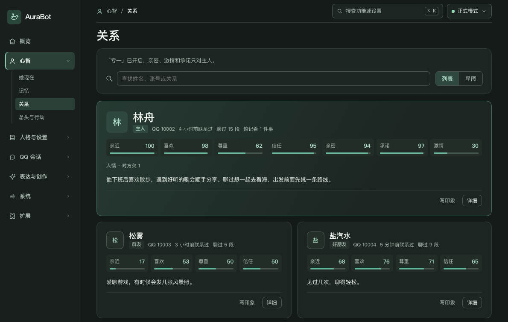

<div align="center">

# AuraBot for macOS

**把大肥鱼接入 QQ，让她在不同会话里延续自己的记忆、心情和关系。**

DeepSeek Harness 插件 · Apple 芯片 Mac · OneBot v11

[下载最新版](https://github.com/Geng-zy/aurabot-qq-mac/releases/latest) · [快速安装](#快速安装) · [使用手册](docs/USER-MANUAL.md) · [English](README_EN.md)

</div>



面板截图来自 AuraBot v1.5.6，使用演示数据。

## 能做什么

| 功能 | 你可以怎么用 |
| --- | --- |
| **QQ 私聊与群聊** | 按白名单开放会话，设置群聊回应、主动插话和连发合并。支持引用、合并转发和语音识别，可为不同会话选择模型。 |
| **记忆、情绪与关系** | 把聊天整理成经历，按日期、关键词或语义回想。可以查看记忆来源和关系变化，调整私聊记忆的可见范围。 |
| **念头与行动** | 查看内心日记、愿望和行动状态。AuraBot 会结合近况、精力与动机决定要不要主动联系你或执行已启用的活动。 |
| **语音、创作与 QQ 空间** | 发语音、使用表情包、翻唱、画图。也可以在「QQ 会话 → QQ 空间」配置空间日记。 |
| **扩展与维护** | 在 DSH 内管理模块、日志、用量和备份。可按需接入桌宠、抖音、小黑盒等模块。 |

## 快速安装

**准备好一台 Apple 芯片 Mac、[DeepSeek Harness](https://github.com/deepseek-ai/deepseek-harness) 桌面版、一套 OneBot v11 网关和单独的机器人 QQ 号。** AuraBot v1.5.10 需要 DSH `0.2.2-rc.3` 或更新版本（客户端硬依赖 DSH UI primitives）。网关可以用 [SnowLuma](https://github.com/SnowLuma/SnowLuma.Docker.Framework)，用 OrbStack 或 Docker Desktop 启动并登录机器人号。已有兼容网关也可直接接入。

1. 打开 DSH 完成首次初始化，在 DSH 里配置聊天模型。去 [Releases](https://github.com/Geng-zy/aurabot-qq-mac/releases/latest) 下载名为 `dsh-aurabot-qq-<版本>.tgz` 的附件。
2. 完全退出 DSH。在终端安装下载的文件，示例里的路径按实际下载位置和版本填写。

   ```bash
   dsh="/Applications/DeepSeek Harness.app/Contents/Resources/runtime/cli/bin/dsh"
   "$dsh" plugin --profile desktop -- add "file:$HOME/Downloads/dsh-aurabot-qq-1.5.10.tgz" --offline
   ```

3. 重开 DSH，从左栏进入 **Aurabot**。按向导填写你的 QQ 号、机器人 QQ 号、OneBot 正向 WebSocket 地址和令牌。
4. 先用「试运行」验证回复。给机器人发一条消息，在「系统 → 日志」看拟回复，确认连接与白名单后再切换「正式模式」。

更新时下载新版本的 `.tgz`，沿用同一命令安装并重启 DSH。插件代码与个人数据分开保存。

[完整设置与排障](docs/USER-MANUAL.md) · [版本更新记录](CHANGELOG.md)

## 在工作台里找到功能

右上角用 **⌥ K** 搜索功能和设置。再次点击当前分组可收起子页；内心日记、愿望、记忆等长列表默认收起。界面动效遵循系统的「减少动态效果」设置。

| 想做什么 | 从哪里进入 |
| --- | --- |
| 查刚刚发生的事或调整隐私 | 心智 → 记忆 |
| 看人物关系或内心日记 | 心智 → 关系 / 念头与行动 |
| 修改人设、性格设置和后台预算 | 人格与设置 |
| 配置 QQ 连接、白名单或空间日记 | QQ 会话 |
| 配置语音、生图或翻唱 | 表达与创作 |
| 看日志、备份或接入自定义脚本 | 系统 |

<details>
<summary>查看关系页和功能搜索截图</summary>

<p><strong>人物关系</strong> · 在人物卡查看称呼、印象、亲近与信任，或切换到星图。</p>


<p><strong>设置搜索</strong> · 输入「向量」，可直接到记忆页并展开「向量检索与精排」。</p>


</details>

## 按需配置本地模型

- **记忆检索**用来找措辞不同、意思相近的经历。在线方式默认选择硅基流动 `BAAI/bge-m3`，开启 `BAAI/bge-reranker-v2-m3` 精排。配置密钥后，检索词与必要的记忆文本会发给接口。也可切换到随包的离线中文向量模型或使用关键词检索。
- **本地小模型**用来处理日常念头。在「人格与设置 → 心智设置 → 本地小模型」按需安装 Qwen3.5-9B 和 MLX 运行环境。
- **本地生图**可以在 Apple 芯片和 macOS 26 或更新版本上一键部署 MFLUX 与 Qwen Image 2.1。也支持自定义本地脚本和兼容的在线接口。语音与翻唱组件可按需从面板安装。

## 数据、开发与来源

| 位置 | 内容 |
| --- | --- |
| `~/.dsh/plugins-data/aurabot/` | 插件设置、人格、记忆、日志与模块数据 |
| `~/Aurabot/` | 默认的 QQ 工作区和本地念头、语音、翻唱环境 |

开发和运行测试需要 Node.js ≥ 22.13.0。在仓库根目录运行 `npm test`。

[使用手册](docs/USER-MANUAL.md) · [功能、设计与实现](docs/FEATURES-AND-IMPLEMENTATION.md) · [维护交接](docs/HANDOFF.md) · [模块开发教程](docs/MODULE-TUTORIAL.md) · [模块 API](src/modules/API.md) · [macOS 模块库](https://github.com/Geng-zy/aurabot-qq-mac-mods)

本仓库由 Geng-zy 维护，fork 自 [aureth-labs/dsh-aurabot-qq](https://github.com/aureth-labs/dsh-aurabot-qq) v1.2.0。QQ 聊天、语音、表情、翻唱、QQ 空间和模块系统承自上游及其贡献者。许可证为 [MIT](LICENSE)，其他项目及许可见[第三方声明](THIRD-PARTY-NOTICES.md)。
