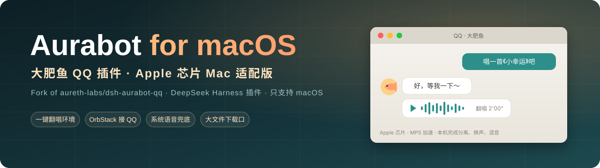
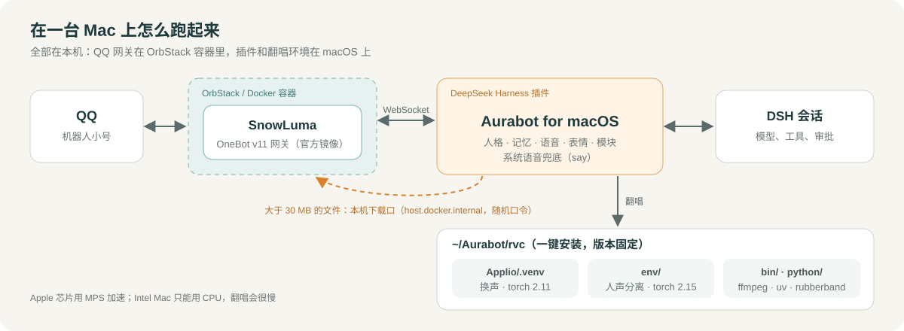

<div align="center">



**让「大肥鱼」在 Apple 芯片的 Mac 上完整跑起来：聊天、语音、发文件、一键翻唱**

**简体中文** · [English](README_EN.md)

[](https://github.com/aureth-labs/dsh-aurabot-qq)
[](#-安装)
[](LICENSE)
[](https://github.com/deepseek-ai/deepseek-harness)

</div>

## 📌 这个仓库是什么

本仓库 **fork 自 [aureth-labs/dsh-aurabot-qq](https://github.com/aureth-labs/dsh-aurabot-qq)**（MIT 许可，从原项目 v1.2.0 分出来）。
原项目是 DeepSeek Harness（DSH）的 QQ 机器人插件「Aurabot / 大肥鱼」：人格、心情、记忆、语音、表情、翻唱、QQ 空间、B 站、模块系统……这些**功能都来自原项目和它的贡献者**。

原作者只适配了 Windows。这个分叉做的事只有一件：**让它在 macOS（Apple 芯片）上完整可用**。为此删掉了 Windows / Linux 专用的代码，所以：

- 用 **Mac** → 装这个仓库；
- 用 **Windows** → 请装[原项目](https://github.com/aureth-labs/dsh-aurabot-qq)。

功能介绍、使用手册、模块市场、交流群都以原项目为准；**只和 Mac 有关的问题**请在本仓库提 issue。

## 🍎 和原项目有什么不同

| 方面 | 原项目（Windows） | 本分叉（macOS） |
|---|---|---|
| 接 QQ | 插件下载、启动、注入 Windows 版 SnowLuma | SnowLuma 没有 Mac 版：在 OrbStack / Docker 里跑它的官方镜像，插件只按填的 OneBot 地址去连 |
| 翻唱环境 | PowerShell 下载、CUDA 版 PyTorch、一套环境 | curl + 自带解压；Apple 芯片用 MPS 加速；**两套环境**（换声、人声分离分开，合成一套会让分离模型失败）；版本全部固定为实测跑通的组合 |
| 翻唱效果 | 分离 → 换声 → 混音 | 另加：本地原唱优先、去混响、拆主唱伴唱 / 男女对唱、按音色档案自动定调和挪八度、音色校正，面板可逐项开关 |
| 语音兜底 | Windows 自带语音（System.Speech） | macOS 自带语音（`say`），不用装任何东西 |
| 发文件 | 网关和插件在同一台机器，按路径直发 | 网关在容器里看不到本机路径：小文件走 base64，**超过 30 MB 走只对本机开放的临时下载口** |
| 面板 | Windows 路径、PowerShell 命令 | 全部换成 Mac 写法，示例路径按你自己的用户目录显示 |

| 她的「脑子」 | 人格卡 + 心情模块 + 记忆模块 + 主动搭话，各管各的 | 换成从头写的**心智核心**（`src/mind/`，见下一节）：一个人只有一个脑子，记忆、情绪、身体、性格、关系、想做什么都在里面 |

逐条的改动说明见 [提交记录](https://github.com/Geng-zy/aurabot-qq-mac/commits/main)。

## 🧠 心智核心

她是一个人：身体、记忆、情绪、性格和关系都存在心智核心里（`~/.dsh/plugins-data/aurabot/mind/mind.sqlite`），每轮重新放进上下文，所以 DSH 的会话换新、被压缩，她本人都不受影响。心智核心在 `src/mind/`，不引用插件的任何代码，接 QQ 的部分在 `src/mind-adapter/`。

- **身体**：精力、困（双过程睡眠模型的简化版）、饿、睡觉和被叫醒、换时区倒时差、投喂。
- **记忆**：按幂函数遗忘（FSRS-4.5 的曲线），想起来会加强、可能被改写（程度可调，原始记录一直保留），每天睡一觉时整理和做梦；向量用 SiliconFlow 免费的 bge-m3。
- **情绪**：66 种情绪，各自的持续时间来自 Verduyn & Lavrijsen 2015；有对象、会调节、会传染，心情有惯性。
- **内心活动和动机**：闲着时一步一步地想（可以用本机的 Qwen3.5-9B 4 位小模型，不花钱），16 项基本需要 + 自己长出来的「想要」，按时间动机理论决定做不做（犯懒是自然出现的），从结果里学；刷 B 站、逛空间、写日记、找你，都由她自己决定什么时候做。
- **性格和关系**：19 项性格（BFI-2 的 15 个小项 + 诚实谦逊 + 依恋两项 + 表达活泼度），只随反复的经历一小步一小步地变，主人的影响有上限；她可以自己改人格卡、名字、价值观，写自己的故事；按 QQ 号记每个人的关系（亲近、喜欢、信任、称呼、心结……），「专一」默认开。
- **所有参数**都在面板「心智设置」里，每项写着默认值、依据（研究出处或「经验值」）和调了会怎样。

## 🗺️ 在一台 Mac 上怎么跑起来



## 🚀 安装

### 需要你自己装、自己设的（只有这些）

| 东西 | 用来做什么 | 说明 |
|---|---|---|
| [DeepSeek Harness](https://github.com/deepseek-ai/deepseek-harness) 桌面版 | 插件跑在它里面 | 在 DSH 设置里配好模型；想让她听懂语音条，再打开 DSH 的「语音输入」插件 |
| [OrbStack](https://orbstack.dev)（或 Docker Desktop） | 跑 QQ 网关 | 第一次打开按提示授权 |
| [SnowLuma](https://github.com/SnowLuma/SnowLuma.Docker.Framework) 容器 | QQ 网关（OneBot v11） | 用官方 docker-compose.yml 启动，在远程桌面（`http://127.0.0.1:6081`）登录机器人小号；NapCat、LLOneBot、Lagrange 等也可以 |
| [Homebrew](https://brew.sh) + `brew install ffmpeg` | 只给「刷 B 站时看视频画面」用 | 可选，不用这个功能就不用装 |

不用装 Python、Xcode 命令行工具、uv、Node、Git，不用改 PATH、不用设环境变量，也不用给任何 macOS 隐私权限。

### 步骤

1. 起好 SnowLuma 容器，登录机器人号。
2. **装插件**（在「终端」里运行），装完重启 DSH，左侧栏会出现 **Aurabot**：

   ```bash
   "/Applications/DeepSeek Harness.app/Contents/Resources/runtime/cli/bin/dsh" plugin --profile desktop add github:Geng-zy/aurabot-qq-mac
   ```
3. **跟着设置向导走**：填机器人 QQ 号和你的 QQ 号，再填 OneBot 正向 WebSocket 地址（一般是 `ws://127.0.0.1:3001`）和令牌。建议先开着「试运行」。
4. 按需在面板里：翻唱页「一键安装」并导入音色、语音页「安装 edge-tts」、扫码登录 B 站 / QQ 空间、填生图接口。

**升级**：再运行一遍上面的安装命令，然后重启 DSH。设置、人格、记忆都会保留；从原项目或旧版本升级时，旧的记忆、心情、人物印象会在第一次启动时自动搬进心智核心。之后请在面板「人格与自我」里确认一次她的性格初始值。

## 🧰 各功能要什么

| 功能 | 需要 |
|---|---|
| 聊天、人格、心情、表情包、QQ 空间、主动找你 | 只要 DSH 里配好的模型 |
| 心智核心（记忆、情绪、身体、性格、关系） | SQLite，用 DSH 自带 Node 里的；后台整理用 DeepSeek（每天的 token 有上限，可调） |
| 想起意思相近的事 | SiliconFlow 的密钥（bge-m3 免费）；不填也能用，只是只按字找 |
| 闲着时的内心活动（本地、不花钱） | 本地小模型（面板「内心」页一键安装，约 5 GB，用时约 6 GB 内存）；不装就用 DeepSeek，想得慢一些 |
| 看图 | 模型支持看图；大图先缩小（有 ffmpeg 用 ffmpeg，没有用 DSH 自带的 sharp） |
| 听语音条 | DSH 的「语音输入」插件 |
| 发语音 | macOS 自带的 `say`（什么都不用装）；想更好听就装语音组件 edge-tts；CosyVoice / GPT-SoVITS / 自定义 HTTP 语音填你自己服务的地址 |
| 翻唱、语音条变声 | 翻唱环境（一键安装） |
| 刷 B 站 | 扫码登录；看视频画面要 ffmpeg |
| 画图 | 生图接口（OpenAI 兼容接口或 Codex 订阅），或本地接口 |
| 发超过 30 MB 的文件 | 不用装，插件自带只对本机开放的临时下载口 |
| 模块市场里的模块（桌宠、抖音等） | 看各模块自己的说明 |

## 📁 插件装的东西放在哪

插件只往这三个地方放东西，都在你的用户文件夹里：

| 位置 | 放什么 |
|---|---|
| `~/.dsh/profiles/desktop/node_modules/dsh-aurabot-qq` | 插件代码（DSH 管理，升级时整个替换） |
| `~/.dsh/plugins-data/aurabot/` | 设置、人格、记忆、表情、日记、日志、翻唱缓存、你装的模块 |
| `~/Aurabot/` | `mind/` 共用的 uv 和 Python + 本地小模型、`rvc/` 翻唱环境、`pyenv/` 语音组件、`qq-chats/` QQ 会话工作区（位置可以在面板里改） |

**共用的 Python** `~/Aurabot/mind`：所有用 Python 的功能（心智核心的本地小模型、翻唱、语音组件）共用一份 uv 和 Python，各自建自己的环境，谁先装谁下载。

| 东西 | 版本 | 位置 |
|---|---|---|
| uv | 0.13.7 | `bin/uv` |
| Python（uv 下载的官方构建） | 3.13.18 | `python/` |
| 本地小模型的环境（mlx 0.32.4、mlx-lm 0.32.2，版本见 `requirements.lock`） | — | `env/` |
| 本地小模型：官方 Qwen/Qwen3.5-9B 下载后在本机转成 4 位（原版权重转完移到废纸篓） | — | `models/Qwen3.5-9B-mlx4` |

**翻唱环境** `~/Aurabot/rvc`（一键安装，约 5 GB，下载都核对校验值）：

| 东西 | 版本 | 位置 |
|---|---|---|
| Applio（RVC 换声）+ 自己的环境 | 3.7.1，torch 2.11 | `Applio/`、`Applio/.venv` |
| 人声分离环境 | audio-separator[cpu] 0.48.0、librosa 1.0.0、audioread 3.1.0、imageio-ffmpeg 0.8.1，torch 2.15 | `env/` |
| ffmpeg（翻唱专用）、Rubber Band 4.0.0 官方版 | — | `bin/` |
| 模型：rmvpe、contentvec；分离模型 BS-Roformer Leap Xe 和去混响 / 拆主唱伴唱 / 分男女声 3 个增强模型 | 固定版本 | `Applio/rvc/models/`、`separator-models/` |
| 你导入的音色和生成的音色档案 | — | `models/` |

装好后导入你有权使用的 RVC 音色（.pth / zip）就能点歌；再用这个音色本人的干声数据集生成「音色档案」，就能自动定调和校正音色。

**语音组件** `~/Aurabot/pyenv`：edge-tts 7.3.1，用上面共用的 Python 3.13.18 和 uv（还没有的话会自己下载到 `~/Aurabot/mind`）。

插件不碰系统的 Python，不往 `~/.cache`、`~/.local` 等系统默认位置留缓存。

## 🧑‍💻 开发

```bash
git clone https://github.com/Geng-zy/aurabot-qq-mac.git
cd aurabot-qq-mac
npm test        # 全部测试；Mac 相关的在 test/macos.test.js、test/file-relay.test.js、test/song-pipeline.test.js
```

需要 Node.js ≥ 22.13.0。插件内部名字保持 `dsh-aurabot-qq` 不变（DSH 靠它找数据目录 `~/.dsh/plugins-data/aurabot`），从原项目换过来不会丢数据。

原项目的文档同样适用：[用户手册](docs/USER-MANUAL.md) · [写模块教程](docs/MODULE-TUTORIAL.md) · [模块 API](src/modules/API.md) · [设计要点](docs/DESIGN.md) · [更新记录](CHANGELOG.md)。

## 📄 License & 致谢

[MIT](LICENSE)，原项目的版权声明保留不变。

- Aurabot 的全部原有功能来自 [aureth-labs/dsh-aurabot-qq](https://github.com/aureth-labs/dsh-aurabot-qq) 及其贡献者。
- 原项目致谢：参考了 [Yuuyuko-uu](https://github.com/Yuuyuko-uu) 的 dsh-qq-bridge 等插件在 DSH 插件机制上踩过的坑；旧版人物记忆的设计来自 [Emotionana](https://github.com/Emotionana) 的 persona-memory（心智核心会把它攒下的印象搬过来）。
- 心智核心的各项默认值来自公开研究（面板「心智设置」每项都写着出处）；本地小模型用 [Qwen3.5-9B](https://huggingface.co/Qwen/Qwen3.5-9B)，经 [MLX](https://github.com/ml-explore/mlx) / [mlx-lm](https://github.com/ml-explore/mlx-lm) 运行。
- 翻唱用到 [Applio](https://github.com/IAHispano/Applio)、[python-audio-separator](https://github.com/nomadkaraoke/python-audio-separator)、[Rubber Band](https://breakfastquay.com/rubberband/)，主分离模型 [BS-Roformer Leap](https://huggingface.co/pcunwa/BS-Roformer-Leap)（unwa）；QQ 网关 [SnowLuma](https://github.com/SnowLuma/SnowLuma)。
