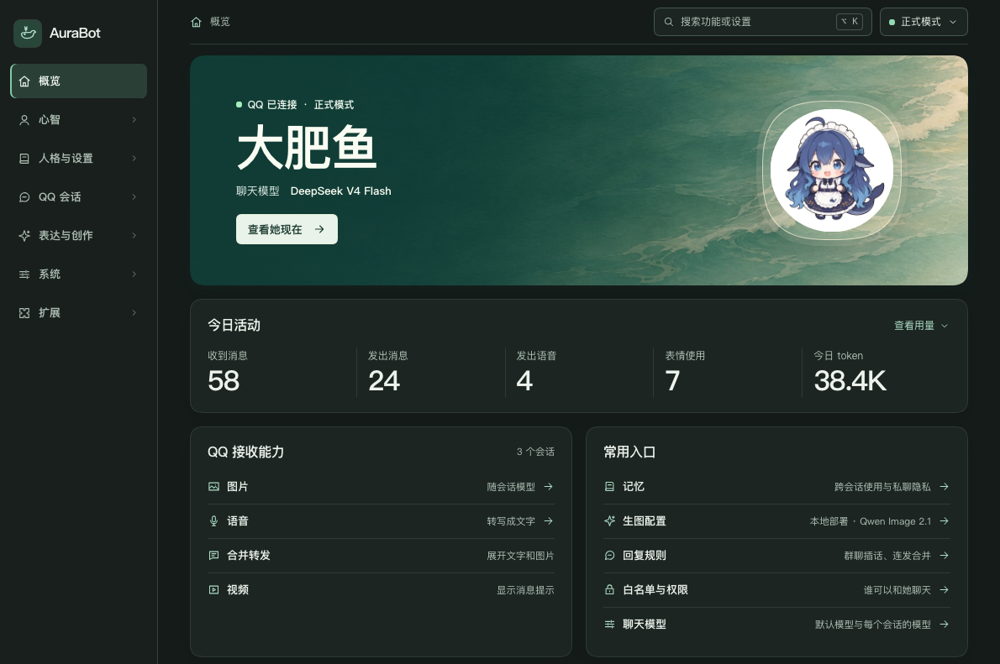
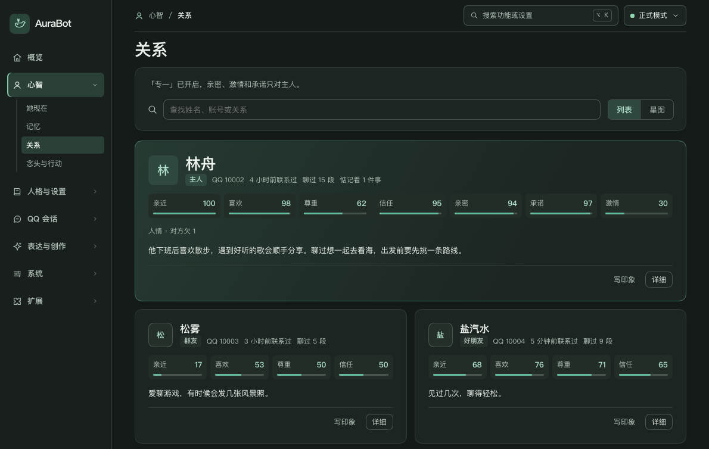
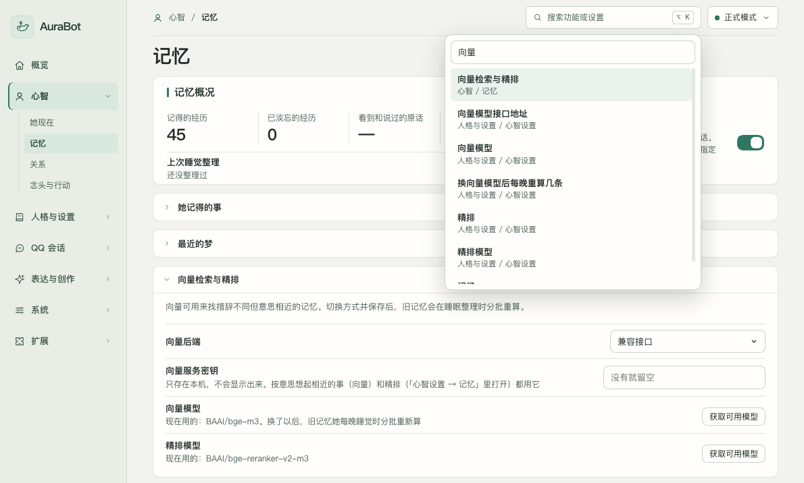

<div align="center">

# AuraBot for macOS

**Bring Dafeiyu to QQ with memories, moods, and relationships that carry across conversations.**

DeepSeek Harness plugin · Apple silicon Macs · OneBot v11

[Latest release](https://github.com/Geng-zy/aurabot-qq-mac/releases/latest) · [Quick start](#quick-start) · [User guide (Chinese)](docs/USER-MANUAL.md) · [简体中文](README.md)

</div>



Screenshots show AuraBot v1.5.6 using demo data. The panel is in Chinese.

## What it does

| Feature | How to use it |
| --- | --- |
| **QQ private and group chats** | Choose which chats can reach AuraBot. Set group reply rules, spontaneous participation, and how closely spaced messages are merged. Use quoted messages, forwarded conversations, voice transcription, and per-chat model settings. |
| **Memory, emotions, and relationships** | Turn chats into experiences and recall them by date, keywords, or meaning. Inspect memory sources and relationship changes, and set where private memories may be used. |
| **Thoughts and actions** | Read the internal journal, wants, and action status. AuraBot uses recent interactions, energy, and motivation when deciding whether to reach out or carry out an enabled activity. |
| **Voice, creative tools, and Qzone** | Send voice messages and stickers, sing covers, generate images, and write Qzone diaries. Enable and configure these tools as needed. |
| **Extensions and maintenance** | Manage modules, logs, usage, and backups inside DSH. Optional modules include a desktop pet, Douyin, and HeyBox. |

## Quick start

**You need an Apple silicon Mac, the desktop version of [DeepSeek Harness](https://github.com/deepseek-ai/deepseek-harness), a OneBot v11 gateway, and a separate QQ account for the bot.** AuraBot v1.5.8 supports DSH `0.2.2-rc.3`. You can run [SnowLuma](https://github.com/SnowLuma/SnowLuma.Docker.Framework) in OrbStack or Docker Desktop, or connect an existing compatible gateway.

1. Open DSH once to initialize it and configure a chat model. Download the `dsh-aurabot-qq-<version>.tgz` asset from the [latest release](https://github.com/Geng-zy/aurabot-qq-mac/releases/latest).
2. Quit DSH completely. Install the archive in Terminal, replacing the example path with the location and version you downloaded.

   ```bash
   dsh="/Applications/DeepSeek Harness.app/Contents/Resources/runtime/cli/bin/dsh"
   "$dsh" plugin --profile desktop -- add "file:$HOME/Downloads/dsh-aurabot-qq-1.5.8.tgz" --offline
   ```

3. Reopen DSH and select **Aurabot** in the sidebar. The setup wizard asks for your QQ ID, the bot's QQ ID, and the OneBot forward WebSocket URL and token.
4. Start in **试运行** (dry run). Send the bot a message and check the proposed reply under **系统 → 日志** (System → Logs). Verify the connection and allowlist before switching to **正式模式** (live mode).

To update, download the new archive, repeat the install command with its path, and restart DSH. Plugin files and personal data are stored separately.

[Setup and troubleshooting in Chinese](docs/USER-MANUAL.md) · [Changelog](CHANGELOG.md)

## Find your way around the panel

Press **⌥ K** to search for a feature or setting. Click the current group again to collapse its subpages. Long sections such as the internal journal, wants, and memory list start collapsed. Transitions follow the system's Reduce Motion preference.

| Where to look | What you'll find |
| --- | --- |
| **心智** · Mind | Current state, memory and privacy, relationships, thoughts and actions |
| **人格与设置** · Persona and settings | Persona card, personality changes, and mind parameters including the background budget |
| **QQ 会话** · QQ | Gateway connection, allowlists and permissions, reply rules, models, and Qzone |
| **表达与创作** · Creative tools | Voice, stickers, image generation, covers, and video via local scripts |
| **系统** · System | Logs, backups, and local integrations |

<details>
<summary>See the relationship panel and settings search</summary>

<p><strong>Relationships</strong> · Browse impressions, nicknames, closeness, and trust, or switch to the relationship graph.</p>


<p><strong>Settings search</strong> · Searching for vectors opens the semantic search and reranking section in Memory.</p>


</details>

## Optional local models

- **Memory search** defaults to SiliconFlow's `BAAI/bge-m3` with `BAAI/bge-reranker-v2-m3` reranking enabled. After you configure a key, queries and relevant memory text are sent to the service. You can select the bundled offline Chinese embedding model or use keyword search.
- **Local thoughts** can use Qwen3.5-9B through MLX. Install it under **人格与设置 → 心智设置 → 本地小模型**.
- **Local image generation** can install MFLUX and Qwen Image 2.1 on Apple silicon with macOS 26 or later. Compatible online endpoints and custom local scripts are also available. Voice and cover components can be installed separately from the panel.

## Data, development, and credits

| Location | Contents |
| --- | --- |
| `~/.dsh/plugins-data/aurabot/` | Plugin settings, persona, memory, logs, and module data |
| `~/Aurabot/` | Default QQ workspace and local environments for thoughts, voice, and covers |

Development and tests require Node.js ≥ 22.13.0. Run `npm test` from the repository root.

[User guide](docs/USER-MANUAL.md) · [Features and implementation](docs/FEATURES-AND-IMPLEMENTATION.md) · [Maintainer handoff](docs/HANDOFF.md) · [Module tutorial](docs/MODULE-TUTORIAL.md) · [Module API](src/modules/API.md) · [macOS module index](https://github.com/Geng-zy/aurabot-qq-mac-mods)

This macOS fork is maintained by Geng-zy and branched from [aureth-labs/dsh-aurabot-qq](https://github.com/aureth-labs/dsh-aurabot-qq) v1.2.0. QQ chat, voice, stickers, song covers, Qzone, and the module system come from upstream and its contributors. See the [MIT license](LICENSE) and [third-party notices](THIRD-PARTY-NOTICES.md).
