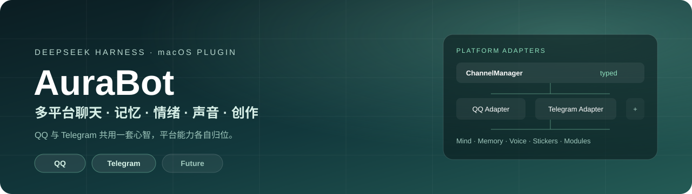

<div align="center">



# AuraBot for macOS

**Bring Aura into QQ and Telegram with one shared memory, mood, and relationship across every conversation.**

A DeepSeek Harness plugin for Apple-silicon Macs · multi-platform adapters · OneBot v11

[](https://github.com/Geng-zy/aurabot-qq-mac/releases/latest)
[](#development)
[](package.json)
[](LICENSE)
[](#platforms)

[Download](https://github.com/Geng-zy/aurabot-qq-mac/releases/latest) · [Install](#install) · [Features](#features) · [Manual](docs/USER-MANUAL.md) · [中文](README.md)

</div>


> The diagram above shows the platform architecture; UI screenshots live in <a href="docs/screenshots/">docs/screenshots</a>.

## What it is

AuraBot is a macOS plugin for [DeepSeek Harness](https://github.com/deepseek-ai/deepseek-harness). It combines chat platforms, persona and memory, model routing, voice, and creative tools in one workspace, with one shared mind behind every platform.

```text
DSH host
   ↓
AuraBot Host
   ↓
ChannelManager
   ├── QQ Adapter        OneBot v11 / forward WebSocket
   ├── Telegram Adapter  long polling Bot API
   └── future adapters
   ↓
Shared: chat hub / mind / memory / knowledge / stickers / voice / media
```

A platform only handles connection, message conversion, and delivery. QQ-only capabilities live under `src/channels/qq/features/` and do not leak into shared modules.

## 1.5.11 highlights

### One fish, one mind

- Memory, emotion, personality, and relationships are shared across conversations.
- Outbound privacy, sharing, reminders, and panel views still respect conversation boundaries.
- Runtime fixes include UTF-8 chunk decoding, Host allowlists, POSIX session paths, avatar upload limits, and QQ WebSocket timeouts.

### Group secretary gate

- Optional cheap-model gate decides whether a group message is worth waking the main model.
- Works on every platform; explicit `@`, replies, and wake words bypass the gate.
- Supports global configuration, per-group overrides and switches, decision logs, persistent statistics, and daily summaries.
- UI: `QQ conversations → Reply rules → Secretary gate / Recent decisions`.

### Knowledge base

- Markdown / txt files under `data/knowledge/raw` and `data/knowledge/notes`.
- Scope by `all / private / group / exact conversation`.
- Panel supports browse, full-text search, highlighting, pagination, preview, note writing, file and folder import with directory structure, rename, and delete.
- Model tools: `knowledge_search`, `knowledge_read`, `knowledge_note_create`.

### Sticker library

- QQ faces, QQ favorites, and QQ market `mface` remain supported.
- Shared library uses exact MD5 deduplication and dHash near-duplicate detection.
- Optional WebP conversion; same-name variants and a primary variant are supported.
- Cross-platform delivery degrades by platform capabilities; QQ market stickers are never forced onto other platforms.

### Image generation

Supported providers:

```text
openai
seedream
xai
gemini
sensenova
comfyui
custom
codex
local
```

- ComfyUI direct mode supports API workflows, prompt nodes, LoadImage references, output nodes, and polling.
- The panel includes a real connectivity test, persisted last-error state, and automatic clearing after success.
- Custom endpoints support URL placeholders, reference images, and response paths.

### Platforms and reliability

- QQ: private/group chat, quotes, forward expansion, voice, files, reactions, group admin, friend/group requests, profile, Qzone.
- Telegram: long polling, text, replies, image upload.
- Other platforms can add a `PlatformAdapter` / `ChannelManager` entry.
- Capabilities use `caps`; unsupported features degrade or skip instead of forcing platform-specific formats.

## Platforms

| Platform | Current capabilities | Where to configure |
| --- | --- | --- |
| **QQ** | private/group chat, replies, forward expansion, voice, files, reactions, group admin, friend/group requests, profile, Qzone | `QQ conversations` |
| **Telegram** | long polling, text, replies, images (base64 images use multipart upload) | `Platforms → Telegram` |
| **Future** | add another `PlatformAdapter` / `ChannelManager` entry | platform-specific page |

## Features

| Area | What you can do |
| --- | --- |
| **Chat** | Allowlist conversations, control group replies and interjections, merge bursts, quotes, and forwarded messages. |
| **Mind** | Recall experiences by date, keyword, or semantics; inspect sources, relationships, and private-memory visibility. |
| **Secretary gate** | Let a lightweight model decide whether a group message deserves the main model. |
| **Knowledge** | Keep settings, references, and notes in a searchable library with per-conversation visibility. |
| **Agency** | Review inner notes, wants, and actions; decide whether to reach out based on mood and energy. |
| **Voice & creation** | Send voice, use stickers, cover songs, generate images/video, and plug in local or hosted services. |
| **Qzone** | Draft posts, preview images, publish with an audience setting, archive media, and handle social interactions. |
| **Maintenance** | Manage modules, logs, usage, and backups from DSH. |

## Install

**Requirements:** Apple-silicon Mac, [DeepSeek Harness](https://github.com/deepseek-ai/deepseek-harness) desktop, DSH `0.2.2-rc.3` or newer. QQ also needs an OneBot v11 gateway (for example [SnowLuma](https://github.com/SnowLuma/SnowLuma.Docker.Framework)) with a dedicated bot account.

1. Initialize DSH and configure a chat model.
2. Download `dsh-aurabot-qq-1.5.55.tgz` from [Releases](https://github.com/Geng-zy/aurabot-qq-mac/releases/latest).
3. Quit DSH and install:

   ```bash
   dsh="/Applications/DeepSeek Harness.app/Contents/Resources/runtime/cli/bin/dsh"
   "$dsh" plugin --profile desktop -- add "file:$HOME/Downloads/dsh-aurabot-qq-1.5.55.tgz" --offline
   ```

4. Reopen DSH and open **Aurabot**.
5. QQ: configure the OneBot WebSocket URL/token, bot account, and owner in `QQ conversations → Connection`.
6. Telegram: configure the Bot Token, owner ID, and allowlists in `Platforms → Telegram`.
7. Start with dry-run, verify the reply in logs, then switch to live mode.

Updating uses the same command with the new `.tgz`, followed by a DSH restart. Plugin code and personal data are stored separately.

[Setup and troubleshooting](docs/USER-MANUAL.md) · [Changelog](CHANGELOG.md)

## UI map

Use **⌥ K** to search settings. Clicking the active group again collapses its subpages. Long lists are collapsed by default. Motion respects the system Reduce Motion setting.

| Task | Where |
| --- | --- |
| Recent events or privacy | Mind → Memory |
| Relationships or inner notes | Mind → Relationships / Thoughts & actions |
| References, notes, and knowledge scope | Mind → Knowledge |
| Persona, traits, background budget | Self & settings |
| QQ connection, allowlists, Qzone | QQ conversations |
| Telegram | Platforms → Telegram |
| Voice, image generation, stickers, covers | Expression & creation |
| Logs, backups, custom scripts | System |

## Development

Requires Node.js ≥ 24.0.0.

```bash
npm test
npm run check
```

Current regression:

```text
393 files syntax-checked
1560 tests passing
```

Offline mind replay:

```bash
npm run mind:replay
npm run mind:privacy
```

## Data and security

| Path | Content |
| --- | --- |
| `~/.dsh/plugins-data/aurabot/` | settings, persona, memory, knowledge, logs, module data |
| `~/Aurabot/` | default QQ workspace and local voice/mind environments |

- Platform tokens, API keys, and WebDAV passwords are never echoed back to the panel.
- Tools degrade according to platform `caps`; platform-specific formats are not forced onto other platforms.
- Host tools in groups are off by default and limited to turns where the owner speaks.
- Review a module's source before installing; modules share the plugin process, and capability declarations are not a sandbox.

## Credits

Maintained by [Geng-zy](https://github.com/Geng-zy). Forked from [aureth-labs/dsh-aurabot-qq](https://github.com/aureth-labs/dsh-aurabot-qq) v1.2.0. QQ chat, voice, stickers, covers, Qzone, and the module system come from the upstream project and its contributors.

[MIT](LICENSE) · [Third-party notices](THIRD-PARTY-NOTICES.md)
