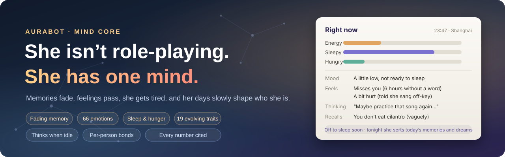
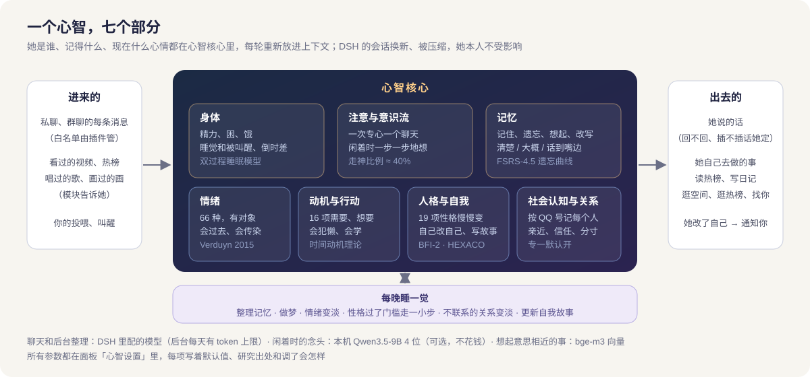

<div align="center">



**A QQ character with a mind of her own: she remembers and forgets, gets happy and hurt, tired and hungry, and her days slowly shape who she is**

A DeepSeek Harness plugin · runs on Apple-silicon Macs

[简体中文](README.md) · **English**

[](#-the-mind-core-she-is-one-person)
[](#-install)
[](LICENSE)
[](https://github.com/aureth-labs/dsh-aurabot-qq)

</div>

## 🧠 The mind core: she is one person

Most character bots are "a persona card plus a chat log": they re-enact the character every turn, forget as the log grows, feel like someone else in a new session, re-judge their mood on every message, and "reach out" on a timer.

Aurabot's mind core works the other way round: **she has exactly one mind**. Memory, emotion, body, motivation, personality and relationships live in it, shared across every chat and put back into context each turn. When a DSH session is rotated or compacted she only loses a few recent details; she herself is unchanged.

| | A typical character bot | Her, with the mind core |
|---|---|---|
| **Memory** | Everything stuffed into context, or keyword search | Fades fast then slowly; recalling strengthens it; vague memories stay vague, some are on the tip of her tongue; one memory leads to the next by association; "what did we do last month?" works by date; she consolidates and dreams while asleep |
| **Mood** | Re-judged every message | Emotions have a target, a reason, and research-based durations (sadness lasts far longer than embarrassment); mood has inertia; anger at one person isn't taken out on another |
| **Daily rhythm** | Always online, always fresh | Gets tired, sleepy and hungry; sleeps during her night and only you can wake her; stays up chatting with you and is sleepier the next day |
| **Initiative** | A timer fires a message; every feature DMs you on its own | Thinks on her own when idle; does what she wants (browse Bilibili, post to Qzone, read trending lists, message you) only when motivated enough; procrastinates; learns from outcomes; modules only do the work — whether to tell you what they found is her call |
| **Personality** | Fixed in the card — or swayed by one message, different every day | 19 traits move in small steps only after repeated experience; your own influence is capped; she can also decide to rewrite her persona, rename herself, write her own story, and start calling you something new as things change between you |
| **Relationships** | Same with everyone | A record per QQ number: closeness, liking, trust, nicknames, inside jokes, no-go topics, grudges; remembers people's pending things (an interview, an exam) and asks how it went; fades without contact; "exclusive" is on by default — romantic feelings are only for you |
| **Group chats** | Fixed interjection probability | She decides, from her sociability, mood, how relevant the topic is to her, and how close she is to who's talking; emoji reactions follow her mood too |
| **Telling you things** | Fixed-format notices | Approval prompts, questions waiting for you, a song that failed — she tells you in her own words |



**Grounded in research, every number adjustable.** Forgetting follows the FSRS-4.5 power curve; emotion durations come from Verduyn & Lavrijsen 2015; sleep pressure from Borbély's two-process model; baseline mood from Diener & Diener 1996 and inertia from Kuppens et al. 2010; mind-wandering from Killingsworth & Gilbert 2010; procrastination from Steel's temporal motivation theory (2007); personality change from Roberts et al. 2017 and Hudson & Fraley 2015; relationships from Sternberg's triangular theory, Rusbult's investment model and attachment theory; association from Collins & Loftus 1975 spreading activation; follow-up questions from Huang et al. 2017; optional reranking after Nogueira & Cho 2019. Every parameter in the panel's mind settings shows its default, its source (or "rule of thumb") and what changing it does.

Panel pages: **Right now** (body, feelings, feed her, wake her), **Inner life** (thoughts, wants, permission requests, local model), **Memory**, **Relationships** (with a star map of who she knows and who appears together, the things she's waiting to hear about, and "stop remembering" / "forget this person" with a 30-day recovery area), **Personality & self** (original vs current traits, her own edits, her story, versions you can roll back) and **Mind settings**.

## 📌 What this repository is

A **fork of [aureth-labs/dsh-aurabot-qq](https://github.com/aureth-labs/dsh-aurabot-qq)** (MIT, branched from upstream v1.2.0), the "Aurabot / Dafeiyu" QQ bot plugin for DeepSeek Harness (DSH). Chat, voice, stickers, song covers, Qzone, Bilibili and the module system **come from upstream and its contributors**.

This fork does two things:

1. **The mind core** (above), written from scratch, replacing upstream's separate memory, mood and speak-up modules. Code in `src/mind/` (imports nothing from the plugin); the QQ side is `src/mind-adapter/`.
2. **macOS (Apple silicon) only**: Windows / Linux-only code was removed. On Windows use [upstream](https://github.com/aureth-labs/dsh-aurabot-qq).

Features from upstream's 1.3.0 beta that don't overlap the mind core were ported and adapted: Breeze TTS, cloud speech recognition, cloud backup (Gitee / WebDAV, always including her mind), DSH sidebar browser, owner-only local tools in groups, emoji reactions, Bilibili QR login, one-click update and security hardening — see the [changelog](CHANGELOG.md).

It keeps the upstream package name and plugin id (`dsh-aurabot-qq`), so it replaces upstream and can't be installed alongside it; when you switch, your old memories, mood and impressions of people move into the mind core on first start.

## 🍎 What differs from upstream

| Area | Upstream (Windows) | This fork (macOS) |
|---|---|---|
| Her "mind" | persona card + mood module + memory module + speak-up, each separate | **mind core**: one mind for memory, emotion, body, motivation, personality and relationships |
| QQ gateway | Plugin downloads, starts and injects Windows SnowLuma | SnowLuma has no macOS build: run its official image in OrbStack / Docker; the plugin only connects to the OneBot address you enter; a one-click diagnosis walks OrbStack → container → ports → logged-in account |
| Song environment | PowerShell, CUDA PyTorch, one environment | curl + built-in unzip, MPS on Apple silicon, **two environments** (voice conversion and vocal separation), every version pinned to a verified set |
| Song quality | separate → convert → mix | plus local originals first, de-reverb, lead/backing or duet split, auto key and octave folding from a per-voice profile, tone matching |
| Fallback TTS | Windows System.Speech | macOS `say` |
| Sending files | gateway reads local paths | gateway in a container can't: small files as base64, **files over 30 MB through a loopback-only temporary download link** |
| Module market | upstream's module index | upstream's plus [this fork's](https://github.com/Geng-zy/aurabot-qq-mac-mods); same-id modules use this fork's mind-core-ready version |
| Notices | fixed-format text | in her own words (approvals, questions, friend / group requests, failed songs) |
| Cloud backup | no mind to include | every Gitee / WebDAV backup includes her mind database, config-only ones too |

## 🚀 Install

**What you install and set up yourself — nothing else:**

| Item | Why | Notes |
|---|---|---|
| DeepSeek Harness desktop | the plugin runs inside it | set up a model in DSH; enable DSH's speech-input plugin if she should understand voice notes |
| [OrbStack](https://orbstack.dev) (or Docker Desktop) | runs the QQ gateway | approve its prompt on first launch |
| [SnowLuma](https://github.com/SnowLuma/SnowLuma.Docker.Framework) container | QQ gateway (OneBot v11) | start the official docker-compose.yml, log the bot account in through its remote desktop (`http://127.0.0.1:6081`); any OneBot v11 implementation works |
| [Homebrew](https://brew.sh) + `brew install ffmpeg` | only for looking at Bilibili video frames | optional |

No Python, Xcode command line tools, uv, Node or Git to install, no PATH or environment variables, no macOS privacy permissions.

1. Start SnowLuma and log the bot account in.
2. Install the plugin in Terminal, then restart DSH:

   ```bash
   "/Applications/DeepSeek Harness.app/Contents/Resources/runtime/cli/bin/dsh" plugin --profile desktop add github:Geng-zy/aurabot-qq-mac
   ```
3. Follow the setup wizard: QQ numbers, then the OneBot forward WebSocket URL (usually `ws://127.0.0.1:3001`) and token.
4. As needed in the panel: one-click song install and import a voice, install edge-tts, scan in to Bilibili / Qzone, add an image API.

Upgrade by running the same command again and restarting DSH; settings, personas and memories are kept. Old memories, mood and impressions of people are moved into the mind core on first start; afterwards confirm her starting personality once in the panel.

## 📁 Where the plugin puts things

Only these three places, all in your home folder:

| Location | Contents |
|---|---|
| `~/.dsh/profiles/desktop/node_modules/dsh-aurabot-qq` | plugin code (managed by DSH, replaced on upgrade) |
| `~/.dsh/plugins-data/aurabot/` | settings, personas, memory, stickers, diaries, logs, cover cache, installed modules |
| `~/Aurabot/` | `mind/` shared uv and Python + local model, `rvc/` song environment, `pyenv/` voice component, `qq-chats/` QQ workspace |

Shared Python `~/Aurabot/mind`: every Python feature shares one uv 0.13.7 (`bin/`) and Python 3.13.18 (`python/`), each with its own environment; the local model's environment is `env/` (mlx 0.32.4, mlx-lm 0.32.2) and the model is official Qwen/Qwen3.5-9B converted to 4-bit on your Mac (`models/Qwen3.5-9B-mlx4`; the original weights go to the Trash afterwards).

Song environment `~/Aurabot/rvc` (about 5 GB, every download checksummed): ffmpeg and Rubber Band 4.0.0 in `bin/`, Applio 3.7.1 with its own environment (torch 2.11), a separate vocal-separation environment `env/` (audio-separator[cpu] 0.48.0, librosa 1.0.0, torch 2.15), the separation and RVC models, and your imported voices in `models/`. Voice component `~/Aurabot/pyenv`: edge-tts 7.3.1 on the shared Python. The plugin never touches the system Python and leaves nothing in `~/.cache` or `~/.local`.

## 📄 License & credits

[MIT](LICENSE); upstream's copyright notice is kept. Original features: [aureth-labs/dsh-aurabot-qq](https://github.com/aureth-labs/dsh-aurabot-qq) and contributors. Covers use [Applio](https://github.com/IAHispano/Applio), [python-audio-separator](https://github.com/nomadkaraoke/python-audio-separator), [Rubber Band](https://breakfastquay.com/rubberband/) and unwa's [BS-Roformer Leap](https://huggingface.co/pcunwa/BS-Roformer-Leap); QQ gateway [SnowLuma](https://github.com/SnowLuma/SnowLuma).
